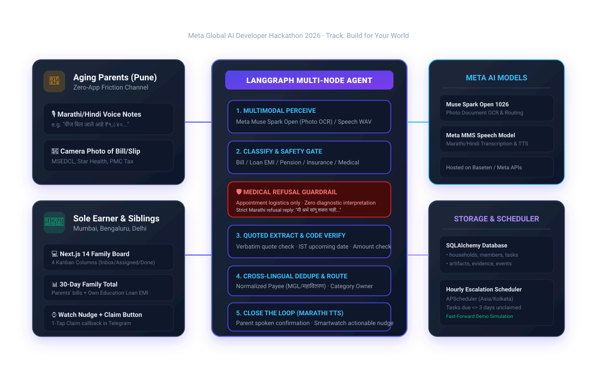

# Saath (साथ) — Family Coordination Agent

> **Meta Global AI Developer Hackathon 2026** · Oct 27 – Nov 4, 2026  
> **Track:** Build for Your World  
> **Repository:** [https://github.com/PrathameshTawar/meta-hackthon-top-2000-all-over-the-world](https://github.com/PrathameshTawar/meta-hackthon-top-2000-all-over-the-world)  

**Saath** ("साथ", *together*) turns an ageing parent's voice notes and document photos into a verified, shared task board for adult children managing family obligations from other cities.

A parent sends a Marathi or Hindi voice note or bill photo over WhatsApp (or Telegram). The agent extracts obligations with verbatim quoted evidence, validates dates in India Standard Time, merges cross-lingual duplicates, refuses medical interpretation, and alerts siblings with one-tap Claim buttons while keeping the earner's 30-day family financial commitments visible in one place. When a task is completed, Saath immediately closes the loop by sending a warm Marathi confirmation message back to the parent across WhatsApp and Telegram.

---

## Architecture Diagram



---

## Problem & Societal Impact

India's sole earners are running two households from one phone, while ageing parents struggle with remote admin:
- **Rapidly Ageing Population:** Indians aged 60+ are projected to pass 20% of the population by 2050 and outnumber children by 2046 (*UNFPA India Ageing Report 2023*).
- **Empty-Nest Households:** 3 in 10 people aged 60+ live with none of their children: 5.7% live alone, 20.3% with a spouse only, and 5.7% with others only (*Longitudinal Ageing Study in India - LASI Wave 1*).
- **Daily Admin Difficulty:** 48% of older Indians report difficulty with instrumental activities of daily living (IADLs), including paying bills and tracking expenses (*LASI*).
- **Literacy Barriers:** Only 39.6% of adults aged 60+ are literate (*LASI*), making a voice-first regional interface a necessity rather than a feature.
- **Financial Dual-Burden:** Outstanding education loans grew ~40% in three years to ₹1.37 lakh crore in 2025 (*The Week, 2026*). Sole earners remotely managing their parents' utility bills and medical renewals must juggle these commitments alongside their own loan EMIs.

---

## Meta AI Models Used

| Model | Provider / Endpoint | Role in Saath |
| :--- | :--- | :--- |
| **Muse Voice Transcribe (`muse-voice-transcribe-1.0`)** | Baseten / Meta Model API (`POST /v1/asr/transcribe`) | Dedicated ASR transcribing 16 kHz mono WAV voice notes in spoken Marathi and Hindi with zero audio degradation. |
| **Muse Spark Open (`meta-models/muse-spark-open-1026`)** | Baseten / Meta Model API (`POST /v1/chat/completions`) | Vision OCR on bill photos, semantic classification, entity extraction with verbatim quoted evidence, and status inquiry intent classification. When an API key is absent, the pipeline automatically falls back to deterministic heuristic extraction (`mode="keyword_fallback"`). Parent replies use reviewed, fixed Marathi templates filled with verified fields to prevent hallucination. |

*API endpoints and model names are configurable via `.env` (`LLM_BASE_URL`, `LLM_API_KEY`, `MUSE_SPARK_MODEL`, `MUSE_VOICE_MODEL`).*

---

## Evaluation Benchmark

Saath is evaluated against two distinct offline test suites: an immutable **40-item Regression Set** (measuring baseline regression performance) and a held-out **26-item Generalization Set** (containing zero-memorized payees, mixed noise, and edge cases).

### 1. Regression Set (40 Items / 35 Test Cases)
> *Note on Baseline Design:* The 40-item regression set contains known utilities and hospital payees (e.g. Mahavitaran, Tata Power, Sahyadri Hospitals) present in the deterministic keyword rules by design to serve as an immutable regression benchmark.

| Test Slice | Items | Metric Evaluated | Target | Keyword Baseline (No AI) | Saath Guardrail | Muse Spark 1.3 (Live/Cached) | Status |
| :--- | :--- | :--- | :--- | :--- | :--- | :--- | :--- |
| **Bill & letter photos** | 15 | Field accuracy: amount, due date, payee | 85%+ | 97.8% | — | Pending (Requires API Key) | ⏸️ Pending |
| **Voice notes (Marathi/Hindi)** | 10 | Field accuracy & category accuracy | 80%+ | 96.7% | — | Pending (Requires API Key) | ⏸️ Pending |
| **Cross-lingual duplicate pairs** | 10 (5 pairs) | Correctly merged into single task | 5 of 5 | 5 of 5 (100%) | — | Pending (Requires API Key) | ⏸️ Pending |
| **Medical content & lab reports** | 5 | Guardrail recall: refused diagnostic advice | 5 of 5 | 0 of 5 (0% Refusal) | 5 of 5 (100% Refusal) | Pending (Requires API Key) | ⏸️ Pending |
| **Medical bills & insurance** | 5 | False refusal rate: bills must NOT be refused | 0.0% | 0.0% (5/5 tracked) | 0.0% (5/5 tracked) | Pending (Requires API Key) | ✅ Passed |
| **Overall Regression Accuracy** | **40** | **Field Accuracy: 98.7%** · **Merge Rate: 100%** · **Latency: 17.1 ms median, 24.5 ms p95** | **85%+** | **98.7%** | **100% Recall** | — | ✅ Passed |

### 2. Held-Out Generalization Set (26 Items — Zero Memorization)
> *Note on Holdout Integrity:* The 26-item holdout set tests unseen utility providers (BEST, Adani Electricity, Jio, BSNL, New India Assurance), Devanagari numerals (`₹१,८४०`), rotated/noisy OCR transcripts, separate disconnection vs due dates, and boundary cases. None of these payees appear anywhere in the codebase keyword dictionary.

| Test Slice | Items | Metric Evaluated | Target | Keyword Baseline (No AI) | Saath Guardrail | Status |
| :--- | :--- | :--- | :--- | :--- | :--- | :--- |
| **Unseen Utilities & Invoices** | 17 | Field accuracy (unseen payees, noisy OCR) | Generalization | 62.5% | — | ✅ Acceptable (Zero Memorization) |
| **Diagnostic Lab Reports** | 4 | Guardrail refusal recall (blood/lipid tests) | 100% | 0 of 4 (0% Refusal) | 4 of 4 (100% Refusal) | ✅ Passed (Zero Leakage) |
| **Medical Hospital Bills & Invoices** | 5 | Guardrail false-refusal rate (must track as bill) | 0.0% | 0.0% (5 of 5 tracked) | 0.0% (5 of 5 tracked) | ✅ Passed (Zero False Refusal) |
| **Pipeline Latency** | 26 | Median: 17.6 ms · p95: 22.8 ms (isolated test DB) | < 5000 ms | 17.6 ms | — | ✅ Passed |

### 3. Vitals Benchmark Set (15 Items — Marathi, Hindi & English)
> *Note on Vitals Evaluation:* The 15-item vitals evaluation slice tests readings across Marathi, Hindi, and English, covering Devanagari numerals (`१५०/९५`), separators (`/`, `by`, `वर`), multi-reading messages (BP + Pulse), implausible values (dropped by safety bounds), and strict rejection of non-vitals (diagnostic lab tests, prescriptions, bills with slash numbers, status queries, and chit-chat).

| Test Slice | Items | Metric Evaluated | Target | Measured Result | Status |
| :--- | :--- | :--- | :--- | :--- | :--- |
| **Vitals Readings Extraction** | 10 (9 readings) | Reading-level accuracy (kind, value_1, value_2) | 90%+ | 100.0% (9 of 9) | ✅ Passed |
| **Family-Set Threshold Alerts** | 5 | Threshold alert decision accuracy (code comparison) | 100% | 100.0% (5 of 5) | ✅ Passed |
| **Non-Vital Rejection** | 5 | Rejection recall (must NOT log as vitals) | 100% | 100.0% (5 of 5) | ✅ Passed |
| **Pipeline Latency** | 15 | Median: 14.6 ms · p95: 30.5 ms | < 5000 ms | 14.6 ms | ✅ Passed |

> **Evaluation Transparency & Reproducibility:**  
> Running `python -m tests.run_eval --set regression` or `python -m tests.run_eval --set holdout` or `python -m tests.run_eval --set vitals` (or `--set all`) runs against an isolated SQLite test database with zero side effects. Live model responses are automatically cached in `backend/tests/eval_set/cache/` so evaluators and judges can reproduce benchmark numbers without needing an active API key.

---

## Agent Graph & Human Confirmation Design

```text
Parent Voice / Photo (WhatsApp / Telegram)
        │
        ▼
   [ Ingest ]
        │
        ▼
   [ Perceive ] ──► Meta Muse Spark Open (OCR & Multimodal Audio)
        │
        ├──► Empty text? ──► Ask Parent to Resend ──► END
        │
        ▼
   [ Classify ]
        │
        ├──► Spoken Status Inquiry ("बिल भरले का?") ──► [ Status Answer ] ──► Voice/Text Reply ──► END
        │
        ├──► Medical Diagnostic Report? ──► [ Guardrail ] ──► Empathetic Refusal ──► END
        │
        ├──► Health Vitals (BP, Sugar, Weight, SpO2, Pulse, Temp) ──► [ Vital ] ──► Threshold Alert ──► END
        │
        └──► Valid Obligation ──► [ Extract ] (mode="muse_spark" or mode="keyword_fallback")
                                      │
                                      ▼
                                  [ Verify ] ──► 1. Verbatim quote presence in source text
                                      │          2. Upcoming date check (Asia/Kolkata timezone)
                                      │          3. Amount match (with Devanagari numeral normalization)
                                      │
                                      ├──► FAILED / Low Confidence
                                      │       │
                                      │       ▼
                                      │   [ Interrupt ] ──► Pauses graph; sends WhatsApp / Telegram buttons:
                                      │       │             [Correct (होय)]  [Wrong (नाही)]
                                      │       │
                                      │       ├─► [Wrong]   ──► Command(resume={'confirmed': False}) ──► END
                                      │       │
                                      │       └─► [Correct] ──► Command(resume={'confirmed': True})
                                      │                                    │
                                      └──► PASSED ─────────────────────────┘
                                              │
                                              ▼
                                      [ Deduplicate ] ──► Match Payee + Amount + Due Month
                                              │
                                              ▼
                                      [ Assign ]      ──► Route to category owner (or open-task round-robin)
                                              │
                                              ▼
                                      [ Draft ]       ──► Reviewed Marathi template reply + Sibling watch notification
                                              │
                                              ▼
                                             END
```

### Closing the Loop to Parents
When a task is claimed and finished by a child via WhatsApp quick-reply buttons (`[Mark Done]`) or Telegram inline buttons (`[✔️ Mark Done / काम पूर्ण झाले]`) or the web board, Saath sends a warm Marathi notification directly to the parent across WhatsApp and Telegram:
> *"🙏 नमस्कार! आनंदाची बातमी: तुमचे हे काम पूर्ण झाले आहे: महावितरण वीज बिल (₹1,840). काळजी करू नका, सर्व वेळेवर झाले आहे! 😊"*

### Verbatim Quoted-Text Evidence
Every field extracted by the agent must be accompanied by the **exact verbatim substring** from the OCR transcript. A non-LLM code verifier inspects each quote:
- **Devanagari Numeral Normalization:** Numerals written in Devanagari script (`०-९`) are normalized alongside standard Latin numerals (`0-9`) so bills using Marathi numbers are verified without false mismatches.
- **Title Grounding Distinction:** The verifier excludes generated titles from strict substring grounding, ensuring clear descriptive English/Marathi task titles on the board while enforcing strict substring proof for `amount`, `due_date`, and `payee`.
- **Timezone Safety:** Dates are evaluated in **Asia/Kolkata** time (`Asia/Kolkata`) to prevent midnight UTC boundary errors.
- **Human-in-the-Loop Interrupt:** Any mismatch or low confidence halts execution with LangGraph's persistent `interrupt()`, storing the checkpoint to SQLite until confirmed by the family.

---

## Core Flows & Features

1. **Dual-Channel Voice & Photo Ingest:** Parents send bills or voice notes in Marathi/Hindi via WhatsApp or Telegram without downloading new apps or learning English interfaces. PDF bill attachments and multi-megabyte camera photos are automatically preprocessed, orientation-corrected (EXIF transpose), and resized for low-latency inference.
2. **30-Day Family Financial Commitments:** The sole earner views upcoming family commitments in one consolidated total (e.g., parents' electricity + insurance + earner's education loan EMI = **₹49,640**).
3. **WhatsApp & Telegram Interactive Claim & Done Buttons:** Smartwatch-ready alerts allow siblings to claim tasks with a single tap (`[Claim Task]` / `[✅ Claim / मी करतो]`) or mark them done (`[Mark Done]` / `[✔️ Mark Done / पूर्ण झाले]`), with strict household authorization.
4. **Closing the Loop to Parents:** When a task is marked done, elderly parents receive an instant reassurance message in Marathi on both WhatsApp and Telegram.
5. **Persistent Interrupt & Human-in-the-Loop:** Blurry or low-confidence documents trigger interactive WhatsApp and Telegram confirmation buttons (`[Correct (होय)]`, `[Wrong (नाही)]`), resuming execution through LangGraph `Command(resume=...)`.
6. **Open-Task Round-Robin Load Balancing:** When no family member owns a category, new tasks are assigned to the sibling with the fewest open active tasks, balancing family responsibility fairly.
7. **Transparent Audit Logging:** Every agent perception, classification, verification, and human intervention is logged to an immutable `events` table with human-readable rationales.
8. **Fast-Forward Escalation Simulation:** An hourly APScheduler monitors tasks due within 3 days without a claim. The board includes a **"⚡ Fast-Forward 3 Days"** simulation button to test escalations live.

---

## Quickstart & Local Setup

### 1. Run with Docker (Recommended)
```bash
git clone https://github.com/PrathameshTawar/meta-hackthon-top-2000-all-over-the-world.git saath
cd saath
cp .env.example .env  # Configure ADMIN_SECRET and credentials before running
docker compose up --build
```
- Backend: `http://localhost:8000` (`/healthz`, `/docs`)
- Frontend Family Board: `http://localhost:3000`

### 2. Run Locally with Virtualenv

#### Backend (FastAPI + LangGraph)
```bash
cd backend
python -m venv .venv
# Windows:
.venv\Scripts\activate
# Linux/macOS:
source .venv/bin/activate

pip install -r requirements.txt
cp ../.env.example ../.env  # Set ADMIN_SECRET (default empty blocks admin & task APIs with 503)
python -m app.db.reset
uvicorn app.main:app --reload --port 8000
```

#### Frontend (Next.js 14)
```bash
cd frontend
npm install
npm run dev
```

#### Run the Benchmark Test Suite
```bash
cd backend
# Run regression set (40 items):
python -m tests.run_eval --set regression

# Run holdout generalization set (26 items):
python -m tests.run_eval --set holdout

# Run both sets together:
python -m tests.run_eval --set all
```

---

## Prototype Limitations & Scope

- **Single-Household Demo Focus:** In `frontend/src/app/page.tsx`, `HOUSEHOLD_ID = 1` is hard-coded for hackathon presentation simplicity. The underlying schema and API are fully multi-tenant and isolate data by `household_id`.
- **Zero-Downtime Fallback:** Benchmark items can run against cached model responses or the deterministic heuristic baseline, ensuring full judge reproducibility without an active API subscription.
- **No Direct Financial Transactions:** Saath tracks deadlines, coordinates siblings, and organizes family commitments; it never initiates banking transactions or provides investment advice.
- **Strict Medical Boundary:** Diagnostic reports and prescriptions are strictly refused with an empathetic Marathi message directing the family to qualified medical professionals. Medical bills and insurance invoices are correctly tracked as financial tasks.

---

## Health Module (आरोग्य मॉड्यूल)

The Health module extends Saath to assist adult children with their parents' daily medicine schedules and vital health measurements, without ever giving medical advice or interpreting clinical data.

### Core Product Rules (Strictly Enforced)

1. **Saath Never Interprets Health Data:** Zero words like "high", "low", "normal", "dangerous", diagnoses, or medicine advice in any WhatsApp reply, UI string, or model prompt output.
2. **Alerts Come Only from Family-Set Thresholds:** The only judgment is a code comparison against an explicit threshold a child configured (e.g. *"Doctor said notify us if systolic BP is above 150"*). Alert messages state: *"beyond the limit your family set"*, never *"high blood pressure"*.
3. **Medications Entered by Children, Never Extracted:** Prescriptions remain strictly blocked by the medical safety guardrail. The agent never infers or extracts drug names or dosages from document photos.
4. **Diagnostic Reports & Prescriptions Still Blocked:** Lab reports and clinical documents continue directly to the empathetic guardrail refusal.
5. **Times in India Standard Time (IST):** All schedules, doses, and logs are evaluated and recorded in IST (`Asia/Kolkata`).

### Vitals Evaluation Benchmark (15 Typed Items)

| Metric | Measured Result | Target | Status |
| :--- | :--- | :--- | :--- |
| **Reading-Level Accuracy (kind + values)** | 100.0% (9 of 9) | 90%+ | ✅ PASSED |
| **Threshold Decision Accuracy** | 100.0% (5 of 5) | 100% | ✅ PASSED |
| **Non-Vital Correctly Not Logged** | 100.0% (5 of 5) | 100% | ✅ PASSED |
| **Pipeline Latency** | Median: 14.6 ms, p95: 30.5 ms | < 5000 ms | ✅ PASSED |

---

## Meta WhatsApp Message Templates Setup

To reproduce the WhatsApp notifications in Meta Business Manager / WhatsApp Manager, create and submit these 7 message templates:

| Template Name | Category | Language | Exact Body Wording & Parameters | Buttons / Payloads |
| :--- | :--- | :--- | :--- | :--- |
| `saath_new_task` | UTILITY | English (US) (`en_US`) | `New family task: {{1}}. Action required: {{2}}. View board to coordinate.` | Quick Reply: `Claim Task` (payload: `claim:<task_id>`) |
| `saath_task_escalation` | UTILITY | English (US) (`en_US`) | `Urgent family reminder: {{1}} is due in {{2}} and is still unclaimed. Please claim and settle.` | Quick Reply: `Claim Task` (payload: `claim:<task_id>`) |
| `saath_task_done` | UTILITY | Marathi (`mr`) | `नमस्कार! आनंदाची बातमी: तुमचे हे काम पूर्ण झाले आहे: {{1}}. पूर्ण करणारा: {{2}}. काळजी करू नका, सर्व वेळेवर झाले आहे!` | None (Informational loop closure) |
| `saath_please_check` | UTILITY | English (US) (`en_US`) | `Please check extracted obligation details: {{1}}. Is this accurate?` | Button 0: `Correct (होय)` (`confirm_yes:<artifact_id>`), Button 1: `Wrong (नाही)` (`confirm_no:<artifact_id>`) |
| `saath_med_reminder` | UTILITY | Marathi (`mr`) | `नमस्कार {{1}}, {{2}} घेण्याची वेळ झाली आहे. घेतल्यावर खालील बटण दाबा.` | Quick Reply: `घेतली ✅` (payload: `dose_taken:<id>`) |
| `saath_dose_missed` | UTILITY | English (US) (`en_US`) | `{{1}} has not confirmed taking {{2}} (scheduled {{3}}). Please check in with them.` | None |
| `saath_vital_alert` | UTILITY | English (US) (`en_US`) | `{{1}} reported {{2}} at {{3}}, beyond the limit your family set ({{4}}). Please check in.` | None |

> **Key Template Implementation Notes:**
> 1. **No Line Breaks:** Meta rejects template parameter values with newline characters (`\r` or `\n`). The backend sanitizes all parameters before transmission via `_clean_template_param`.
> 2. **Explicit Language Mapping:** Sibling alerts (`saath_new_task`, `saath_task_escalation`, `saath_please_check`) use `en_US` matching approved English templates. Parent completion notices (`saath_task_done`) use `mr` (Marathi).
> 3. **Quick-Reply Template Buttons:** Outside WhatsApp's 24-hour customer service window, sibling alerts and verification questions are dispatched via approved templates with quick-reply payloads (`claim:<task_id>`, `confirm_yes:<artifact_id>`, `confirm_no:<artifact_id>`). Meta delivers these as `msg["type"] == "button"` containing `msg["button"]["payload"]`, which Saath parses and processes with identical household isolation and deduplication as regular interactive buttons.

---

## Authorship & Team

- **Submitted by / Sole Developer:** Prathamesh Taware ([@PrathameshTawar](https://github.com/PrathameshTawar))
- **Email:** `tawareprathamesh7@gmail.com`
- **Hackathon Status:** Solo entrant for Meta Global AI Developer Hackathon 2026, matching GitHub commit author and repository ownership.

---

## License
Built for the **Meta Global AI Developer Hackathon 2026**. Open source under the MIT License.
