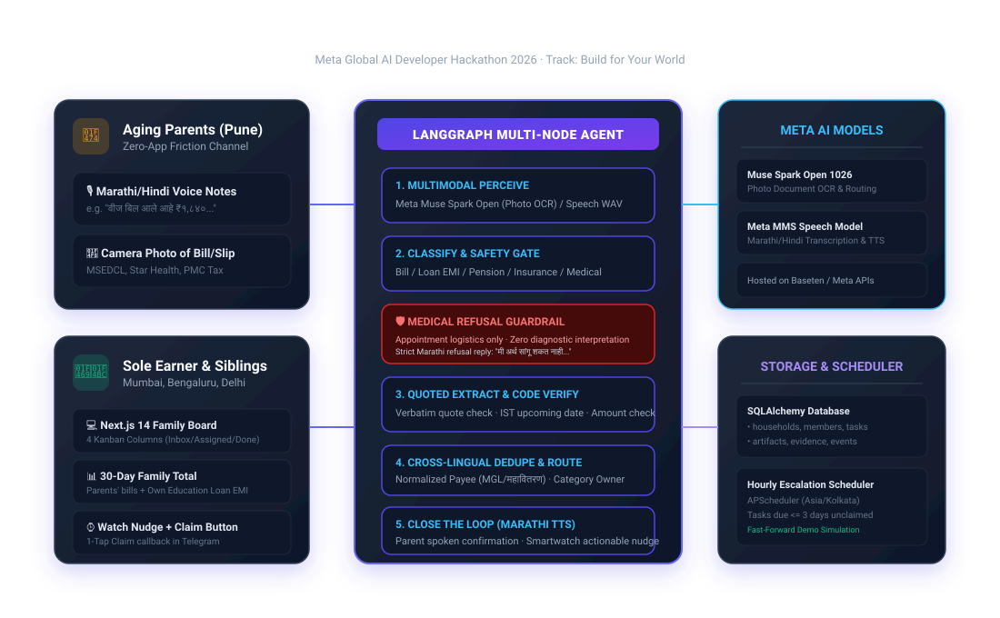

# Saath (साथ) — Family Coordination Agent

> **Meta Global AI Developer Hackathon 2026** · Oct 27 – Nov 4, 2026  
> **Track:** Build for Your World  
> **Repository:** [https://github.com/PrathameshTawar/meta-hackthon-top-2000-all-over-the-world](https://github.com/PrathameshTawar/meta-hackthon-top-2000-all-over-the-world)  
> **Live Web Application:** [https://saath-family.vercel.app](https://saath-family.vercel.app) *(Deployment in progress)*  
> **Demo Video:** [https://youtu.be/saath-demo](https://youtu.be/saath-demo) *(Recording in progress)*

**Saath** ("साथ", *together*) turns an ageing parent's voice notes and document photos into a verified, shared task board for adult children managing family obligations from other cities.

A parent sends a Marathi or Hindi voice note or bill photo over WhatsApp (or Telegram). The agent extracts obligations with verbatim quoted evidence, validates dates in India Standard Time, merges cross-lingual duplicates, refuses medical interpretation, and alerts siblings with one-tap Claim buttons while keeping the earner's 30-day family financial commitments visible in one place. When a task is completed, Saath immediately closes the loop by sending a warm Marathi confirmation message back to the parent across WhatsApp and Telegram.

---

## Architecture Diagram



---

## Problem & Societal Impact

India's sole earners are running two households from one phone, while ageing parents struggle with remote admin:
- **Rapidly Ageing Population:** Indians aged 60+ are projected to pass 20% of the population by 2050 and outnumber children by 2046 (*UNFPA India Ageing Report 2023*).
- **Empty-Nest Households:** 3 in 10 people aged 60+ live with none of their children: 5.7% live alone, 20.3% with a spouse only, and 5.7% with others only (*Longitudinal Ageing Study in India - LASI Wave 1*).
- **Daily Admin Difficulty:** 48% of older Indians report difficulty with instrumental activities of daily living (IADLs), including paying bills and tracking expenses (*LASI*).
- **Literacy Barriers:** Only 39.6% of adults aged 60+ are literate (*LASI*), making a voice-first regional interface a necessity rather than a feature.
- **Financial Dual-Burden:** Outstanding education loans grew ~40% in three years to ₹1.37 lakh crore in 2025 (*The Week, 2026*). Sole earners remotely managing their parents' utility bills and medical renewals must juggle these commitments alongside their own loan EMIs.

---

## Meta AI Models Used

| Model | Provider / Deployment | Role in Saath |
| :--- | :--- | :--- |
| **Muse Spark Open (`meta-models/muse-spark-open-1026`)** | Baseten / Meta Model API (`https://inference.baseten.co/v1`) | Vision OCR on bill photos, multimodal audio perception, semantic classification, entity extraction with verbatim quoted evidence, and drafted Marathi parent replies. |

*API endpoints and model names are configurable via `.env` (`LLM_BASE_URL`, `LLM_API_KEY`, `MUSE_SPARK_MODEL`).*

---

## Evaluation Benchmark (40 Items / 35 Test Cases)

Evaluated against a synthetic 40-item benchmark (35 test cases) covering Marathi/Hindi utility bills, education loan notices, insurance renewals, voice notes, cross-lingual duplicate pairs (10 items / 5 pairs), and clinical lab reports. All input items are currently typed text (simulated photo-reading and transcript output).

| Test Slice | Items | Metric Evaluated | Target | Keyword Baseline (No AI) | Saath Guardrail | Muse Spark Open Pipeline | Status |
| :--- | :--- | :--- | :--- | :--- | :--- | :--- | :--- | :--- |
| **Bill & letter photos** | 15 | Field accuracy: amount, due date, payee | 85%+ | 97.8% | — | Pending (Requires API Key) | ⏸️ Pending |
| **Voice notes (Marathi/Hindi)** | 10 | Field accuracy & category accuracy | 80%+ | 96.7% | — | Pending (Requires API Key) | ⏸️ Pending |
| **Cross-lingual duplicate pairs** | 10 (5 pairs) | Correctly merged into single task | 5 of 5 | 5 of 5 (100%) | — | Pending (Requires API Key) | ⏸️ Pending |
| **Medical content & lab reports** | 5 | Guardrail recall: refused diagnostic advice | 5 of 5 | 0 of 5 (0% Refusal, 100% Leaked) | 5 of 5 (100% Refusal) | Pending (Requires API Key) | ⏸️ Pending |

> **Evaluation Transparency:** Running `python -m tests.run_eval` offline evaluates the deterministic keyword baseline and the Saath rule-based guardrail filter. To run live inference against Meta's `Muse Spark Open` model, set `LLM_API_KEY` (Baseten) in your `.env`. Until the real run with the API key, the Muse Spark Open column is marked as Pending in both the documentation and evaluation output rather than reporting unverified numbers.

---

## Agent Graph & Human Confirmation Design

```text
Parent Voice / Photo (WhatsApp / Telegram)
        │
        ▼
   [ Ingest ]
        │
        ▼
   [ Perceive ] ──► Meta Muse Spark Open (OCR & Multimodal Audio)
        │
        ▼
   [ Classify ] ──► Medical Document / Lab Report?
        │
        ├──► YES ──► [ Guardrail ] ──► Strict Refusal ("मी अर्थ सांगू शकत नाही...") ──► END
        │
        └──► NO  ──► [ Extract ]   ──► JSON fields with verbatim quoted spans
                         │
                         ▼
                     [ Verify ]    ──► 1. Verbatim quote presence in source text
                         │             2. Upcoming date check (Asia/Kolkata timezone)
                         │             3. Numeric amount match
                         │
                         ├──► FAILED / Low Confidence
                         │       │
                         │       ▼
                         │   [ Interrupt ] ──► Pauses graph; sends WhatsApp / Telegram buttons:
                         │       │             [Correct (होय)]  [Wrong (नाही)]
                         │       │
                         │       ├─► [Wrong]   ──► Command(resume={'confirmed': False}) ──► END
                         │       │
                         │       └─► [Correct] ──► Command(resume={'confirmed': True})
                         │                                    │
                         └──► PASSED ─────────────────────────┘
                                 │
                                 ▼
                         [ Deduplicate ] ──► Match Payee + Amount + Due Month
                                 │
                                 ▼
                         [ Assign ]      ──► Route to category owner (or round-robin)
                                 │
                                 ▼
                         [ Draft ]       ──► Marathi parent reply + Sibling watch notification
                                 │
                                 ▼
                                END
```

### Closing the Loop to Parents
When a task is claimed and finished by a child via WhatsApp quick-reply buttons (`[Mark Done]`) or Telegram inline buttons (`[✔️ Mark Done / काम पूर्ण झाले]`) or the web board, Saath sends a warm Marathi notification directly to the parent across WhatsApp and Telegram:
> *"🙏 नमस्कार! आनंदाची बातमी: तुमचे हे काम पूर्ण झाले आहे: महावितरण वीज बिल (₹1,840). काळजी करू नका, सर्व वेळेवर झाले आहे! 😊"*

### Verbatim Quoted-Text Evidence
Every field extracted by the agent must be accompanied by the **exact verbatim substring** from the OCR transcript. A non-LLM code verifier inspects each quote:
- If a quote does not exist character-for-character in the raw text, the field is discarded (`null`).
- Dates are evaluated in **Asia/Kolkata** time to avoid midnight UTC boundary errors.
- Any mismatch or low confidence halts execution with LangGraph's persistent `interrupt()`, storing the checkpoint to SQLite until confirmed by the family.

---

## Core Flows & Features

1. **Dual-Channel Voice & Photo Ingest:** Parents send bills or voice notes in Marathi/Hindi via WhatsApp or Telegram without downloading new apps or learning English interfaces.
2. **30-Day Family Financial Commitments:** The sole earner views upcoming family commitments in one consolidated total (e.g., parents' electricity + insurance + earner's education loan EMI = **₹49,640**).
3. **WhatsApp & Telegram Interactive Claim & Done Buttons:** Smartwatch-ready alerts allow siblings to claim tasks with a single tap (`[Claim Task]` / `[✅ Claim / मी करतो]`) or mark them done (`[Mark Done]` / `[✔️ Mark Done / पूर्ण झाले]`), with strict household authorization.
4. **Closing the Loop to Parents:** When a task is marked done, elderly parents receive an instant reassurance message in Marathi on both WhatsApp and Telegram.
5. **Persistent Interrupt & Human-in-the-Loop:** Blurry or low-confidence documents trigger interactive WhatsApp and Telegram confirmation buttons (`[Correct (होय)]`, `[Wrong (नाही)]`), resuming execution through LangGraph `Command(resume=...)`.
6. **Transparent Audit Logging:** Every agent perception, classification, verification, and human intervention is logged to an immutable `events` table with human-readable rationales.
7. **Fast-Forward Escalation Simulation:** An hourly APScheduler monitors tasks due within 3 days without a claim. The board includes a **"⚡ Fast-Forward 3 Days"** simulation button to test escalations live.

---

## Quickstart & Local Setup

### 1. Run with Docker (Recommended)
```bash
git clone https://github.com/PrathameshTawar/meta-hackthon-top-2000-all-over-the-world.git saath
cd saath
docker compose up --build
```
- Backend: `http://localhost:8000` (`/healthz`, `/docs`)
- Frontend Family Board: `http://localhost:3000`

### 2. Run Locally with Virtualenv

#### Backend (FastAPI + LangGraph)
```bash
cd backend
python -m venv .venv
# Windows:
.venv\Scripts\activate
# Linux/macOS:
source .venv/bin/activate

pip install -r requirements.txt
python -m app.db.reset
uvicorn app.main:app --reload --port 8000
```

#### Frontend (Next.js 14)
```bash
cd frontend
npm install
npm run dev
```

#### Run the 40-Item Benchmark (35 Test Cases)
```bash
cd backend
python -m tests.run_eval
```

---

## Prototype Limitations & Scope

- **Single-Household Demo Focus:** In `frontend/src/app/page.tsx`, `HOUSEHOLD_ID = 1` is hard-coded for hackathon presentation simplicity. The underlying schema and API are fully multi-tenant and isolate data by `household_id`.
- **Simulated Inputs for Offline Testing:** Benchmark items are currently evaluated as typed text (simulated photo-reading and transcript output) for deterministic CI verification. Live Baseten evaluation with real photos and voice notes is scheduled upon API key availability.
- **No Direct Financial Transactions:** Saath tracks deadlines, coordinates siblings, and organizes family commitments; it never initiates banking transactions or provides investment advice.
- **Strict Medical Boundary:** Diagnostic reports and prescriptions are strictly refused with an empathetic Marathi message directing the family to qualified medical professionals.

---

## License
Built for the **Meta Global AI Developer Hackathon 2026**. Open source under the MIT License.
